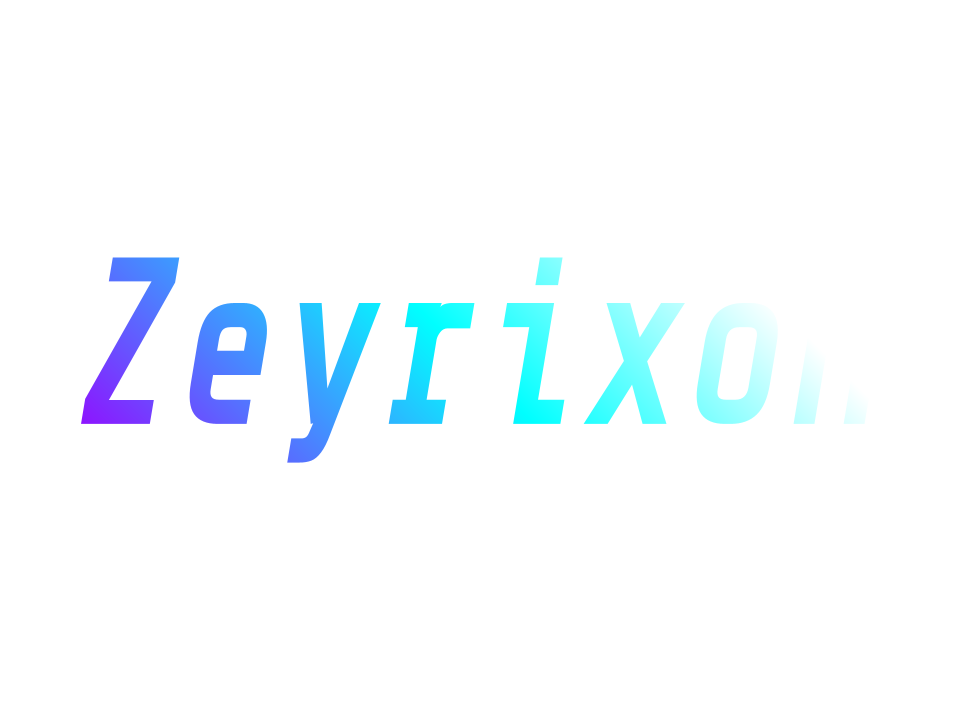
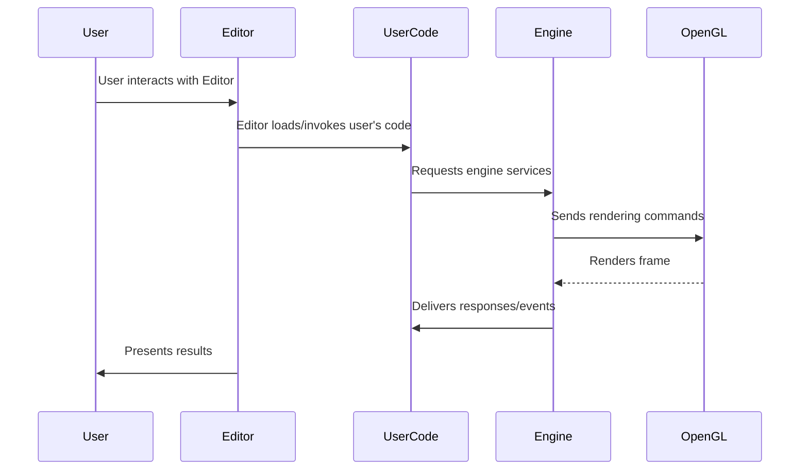

TL;DR: Zeyrixon is a cross-platform (Linux/Windows) game engine + editor using OpenGL. macOS is not supported — PRs welcome.

**Table of contents**

- [Overview](#overview)
- [Quick start](#quick-start)
- [Generate projects](#generate-projects)
- [Build (Makefile)](#build-makefile)
- [Build (Visual Studio)](#build-visual-studio)
- [Run](#run)
- [Scripting (AngelScript)](#scripting-angelscript)
- [Making a game project](#making-a-game-project)
- [Supported platforms](#supported-platforms)
- [Languages used](#languages-used)
- [Architecture diagram](#architecture-diagram)
- [Examples](#examples)
- [Troubleshooting](#troubleshooting)
- [Contributing](#contributing)
- [License](#license)

## Overview

Zeyrixon is an engine + editor project built with C/C++ and OpenGL. The goal is to provide a lightweight, flexible engine that runs on Linux and Windows. The editor uses a custom workflow and premake for project generation.

## Quick start

### 1. Clone with submodules

Dependencies (GLFW, ImGui, glm, spdlog, etc.) are git submodules:

```bash
git clone --recursive https://github.com/UnderTheBedStudios/Zeyrixon.git
# already cloned without --recursive?
git submodule update --init --recursive
```

### 2. Prerequisites

Premake is bundled in `vendor/binary/`, so you don't need to install it.

**Linux**
- GCC or Clang with C++20 support, and `make`
- X11 development headers (GLFW is built against X11; Wayland works via XWayland)
- A file-dialog helper for the editor (`zenity` or `kdialog`)

| Distro | Packages |
|---|---|
| Arch | `base-devel libx11 libxrandr libxinerama libxcursor libxi zenity` |
| Debian/Ubuntu | `build-essential libx11-dev libxrandr-dev libxinerama-dev libxcursor-dev libxi-dev libgl-dev zenity` |
| Fedora | `gcc-c++ make libX11-devel libXrandr-devel libXinerama-devel libXcursor-devel libXi-devel mesa-libGL-devel zenity` |

**Windows**
- Visual Studio 2022 with the "Desktop development with C++" workload

### 3. Generate project files

```bash
# Linux
./GenerateProjects.sh

# Windows (PowerShell or cmd)
GenerateProjects.bat
```

> Project files embed this folder's absolute path (used to find editor assets).
> If you move or rename the folder, re-run the generate script.

Then build (see below).

2. Build (Makefile method) or open the generated solution in Visual Studio (see below).

## Generate projects

- Linux/macOS: `./GenerateProjects.sh` (creates Makefiles and workspace files).
- Windows: `GenerateProjects.bat` (creates Visual Studio solution and project files).

The scripts use premake to produce the appropriate project files.

## Build (Makefile)

From the engine root (after running the appropriate generate script):

```bash
make config=debug     # debug build
make config=release   # release build
make config=dist      # distribution build
```

Binaries are placed under `bin/Config-platform-architecture/` (for example `bin/Debug-linux-x86_64/`).

## Build (Visual Studio)

1. Run `GenerateProjects.bat` on Windows.
2. Open the generated `.sln` in Visual Studio.
3. Choose `Debug`, `Release`, or `Dist` and build.

## Run

After building, open the appropriate folder under `bin/` and run either `TestProj` or `ZeyrixonEditor`.

## Scripting (AngelScript)

Game logic is written in [AngelScript](https://www.angelcode.com/angelscript/) (`.as` files), so people who don't know C++ can still make a game. A script file holds one class, named like the file:

```angelscript
class Mover
{
    Entity entity;          // the engine fills this in: the entity the script is attached to
    float speed = 2.0f;

    void OnCreate() { Log::Info("Hello from " + entity.name); }   // when Play starts
    void OnUpdate(float dt)                                       // every frame
    {
        Vec3 p = entity.position;      // a copy: change it, then assign it back
        p.x += speed * dt;
        entity.position = p;
    }
    void OnDestroy() {}                                           // when Play stops
}
```

Attach it with **Add Component -> Script** in the editor, set **Path** (relative to the project's `Assets` folder, for example `Scripts/Mover.as`) and press **Play**. Compile errors and script exceptions appear in the Logger panel. Pressing **Stop** puts every transform back the way it was.

What scripts can use:

| Name | What it is |
|---|---|
| `Entity` | `name`, `position`, `rotation` (degrees), `scale`, `id`, `IsValid()`, `Forward()`, `Right()`, `Up()` |
| `FindEntity("Name")` | Looks an entity up by its name |
| `Vec3` | `x y z`, `+ - * /`, `Length()`, `Normalized()`, `Dot()`, `Cross()`, `Distance()` |
| `Log::Info/Warn/Error/Trace`, `Print` | Writes to the Logger panel |
| `Input::IsKeyDown(Key::W)`, `Input::IsMouseDown(MouseButton::Left)`, `Input::MouseX()/MouseY()` | Input |
| `string`, `array<T>`, `sin cos sqrt pow ...` | The standard AngelScript add-ons |

To offer your own C++ to scripts, register it on `Zeyrixon::ScriptEngine::GetEngine()` (see `Zeyrixon/src/Zeyrixon/Scripting/ScriptEngine.cpp` for how `Entity` and `Vec3` are done).

## Making a game project

**File -> New Project** in the editor creates a folder with:

```
MyGame/
  MyGame.zeyrixon        project manifest
  premake5.lua           connects the game to the engine (see below)
  GenerateProjects.sh/.bat
  src/main.cpp           the game's C++ entry point (loads the project and runs it)
  Assets/Worlds/        worlds
  Assets/Scripts/       AngelScript files (Example.as is created for you)
```

`premake5.lua` sets `ZEYRIXON_DIR` (where the engine is; override with the environment variable of the same name) and includes `premake/ZeyrixonGame.lua` from the engine. Calling `ZeyrixonLink()` in the game's `project` block adds the engine's headers, libraries, defines and system libraries, so the game can use everything the engine has.

To build a game: build the engine once (`make config=debug` in the engine folder), then in the game folder run `./GenerateProjects.sh`, `make config=debug` and run the executable in `bin/`.

## Supported platforms

- Linux (actively tested on Arch Linux)
- Windows (tested via collaborators)

macOS is not supported by the author. If you get it working, open a PR — you will be credited.

## Languages used

| Language   | Where used                | Notes                         |
|---:        |---:                       |---:                           |
| C / C++    | Engine, Editor, User code | High performance core         |
| HTML / CSS | User-created UI           | For editor/user UI creation   |
| AngelScript| Game scripts (`.as`)      | Easy to learn, C++-like syntax |

## Architecture diagram


## Examples
### Multi Material Meshes examples:


## Troubleshooting

- If builds fail: ensure you ran the appropriate `GenerateProjects` script first.
- On Linux, verify `gcc`/`clang`, `make`, and `premake` are installed and on `PATH`.
- If Windows builds fail for missing dependencies, check the vendor/ folders (e.g., GLFW, spdlog).

## Contributing

Contributions are welcome. If you want to add macOS support, submit a PR and include build instructions and CI if possible. For other contributions, open issues or PRs and include a brief description of your change.

## License

This project is released under the MIT License. See [LICENSE](LICENSE) for details.

---

Thanks for checking out Zeyrixon — enjoy!
